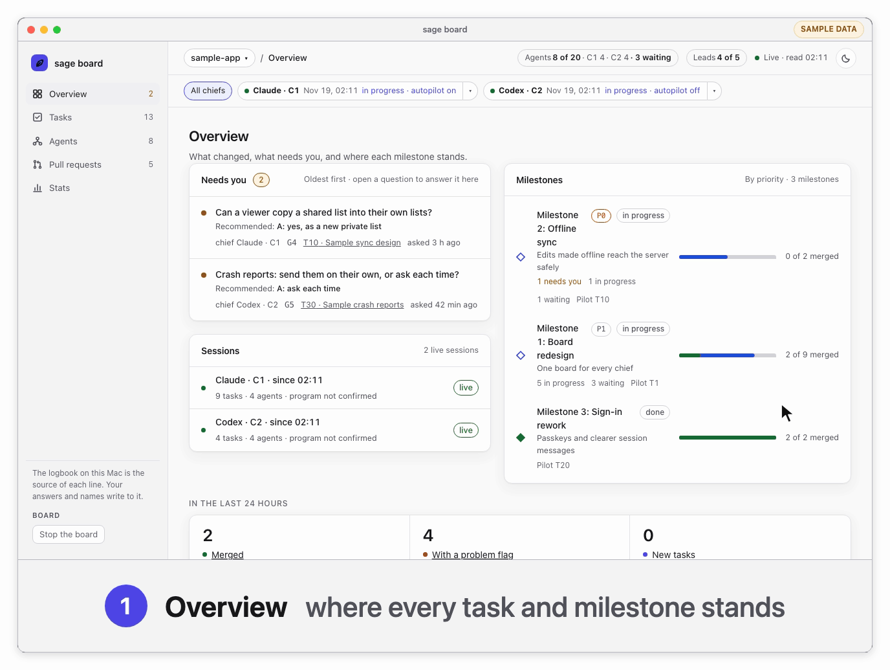

# sage-stack

**sage-stack is a multi-agent development stack for Claude Code and Codex: a team of agents builds, reviews and proves your work, and you review results instead of code.**
You turn on sage mode in a session, and the session becomes your chief of staff. You say what you want; agents design, build, review and test it, and you get a pull request with evidence.

<p align="center">
  <a href="https://github.com/erickb336/sage-stack/actions/workflows/check.yml"></a>
  <a href="LICENSE"></a>
</p>

**Status:** early, used every day by its author to build sage-stack itself. Claude Code is supported; in Codex (the CLI and the desktop app), sage mode, autopilot, the shared logbook and the board phrases work through the sage plugin ([sage in Codex](docs/guide/codex.md)). Tested on macOS, and in CI on Ubuntu (Linux); Windows is not supported.

Start with the [Quick start](#quick-start). Then follow one task from start to merge in [Learn sage in 5 minutes](docs/guide/learn-sage.md).

<a href="docs/assets/hero-light.svg">
<picture>
  <source media="(prefers-color-scheme: dark)" srcset="docs/assets/hero-dark.svg">
  
</picture>
</a>

## Why "sage"?

In *Naruto*, a sage stays still to gather natural energy, and sees more than in normal combat. sage mode works the same way (a mode that you turn on by name comes from pstack's **poteto mode**):

- **It stays still.** The chief of staff changes no files.
- **It gathers energy.** Agents work in parallel, each in its own git worktree.
- **It sees the whole.** It keeps the logbook, groups the tasks of one goal into a milestone, and gives a mistake that comes back a lasting fix.

## Quick start

For Claude Code. For Codex, see [In Codex](#in-codex) below. Before you start:

- Install Claude Code and sign in, with a Claude plan or API credits ([install Claude Code](https://code.claude.com/docs/en/setup)).
- Install Node.js 20 or later (the minimum; CI runs the tests on Node 24), git and `gh`, and log in to `gh` (`gh auth login`). sage uses `gh` and your project's GitHub remote for pull requests; without a remote, work stops at a verified branch.

1. Install sage, in a terminal:
   ```sh
   claude plugin marketplace add erickb336/sage-stack
   ```
   ```sh
   claude plugin install sage@sage
   ```
   You see `Successfully installed plugin: sage@sage (scope: user)`.
2. Start a new session in a project folder: run `claude`. A session that was already open does not get sage.
3. Send the on phrase, the words below, as a message of its own, with no other words:
   ```text
   sage mode
   ```
   You see: the chief says that sage mode is on, and waits for your request.
4. Say what you want in the next message, for example `Fix the crash on an empty search.`
   You see: the chief frames the task, asks its product questions in one batch, then brings evidence and a pull request.

To update sage, run this in a terminal, then start a new session. To stop a task or uninstall sage, see [Using sage](docs/guide/using-sage.md).
```sh
claude plugin update sage@sage
```

> **Warning:** before you use milestones (tasks of one goal) or tasks that wait for other tasks, update sage and restart every session that was already open. An older session still merges a waiting task, or a task of a milestone that you did not approve.

### In Codex

The same phrases, logbook and board work in Codex. You need Codex 0.164 or later and its CLI (also for the desktop app), and one line in your Codex config. You also need Node.js 20 or later, `gh` logged in, and a GitHub remote for the project (see [What you need](docs/guide/codex.md#what-you-need)).

1. Add the sage marketplace and install sage, in a terminal:
   ```sh
   codex plugin marketplace add https://github.com/erickb336/sage-stack.git
   ```
   ```sh
   codex plugin add sage@sage
   ```
2. Install sage's hooks once on each computer with the plugin's `hooks install` command, then run `codex` in a project folder and choose **Trust all and continue** at the "Hooks need review" screen ([Install](docs/guide/codex.md#install), step 3). Without that trust, no sage hook runs, so do the [gate check](docs/guide/codex.md#check-that-the-sage-gate-runs).
3. Send `sage mode` alone, then your request. Codex asks you at least 5 times in each small task (the worktree, the add, the commit, the push and the pull request): read the choices, then approve ([The approval prompts](docs/guide/codex.md#the-approval-prompts-of-each-task)).

## The board

Send `show board` to see the board in the chat: what needs you, the sessions and agents at work, and each task by its state. On a Mac, it also starts the board in the browser and gives you a link ([The board](docs/guide/board.md)).

<picture>
  <source media="(prefers-color-scheme: dark)" srcset="docs/assets/board-walkthrough-dark.gif">
  
</picture>

*The board on a laptop screen, with sample data. Watch the full tour below, or read the [board guide](docs/guide/board.md).*\
*Below: a full tour of all 9 board pages, with sample data (53 seconds). If no player shows, open the [MP4 file](docs/assets/board-tour.mp4).*

https://github.com/user-attachments/assets/f9d9da6e-ae5a-40d3-80b7-2c588b4f9565

## What to say

| Say | What happens |
| --- | --- |
| `sage mode` | The session becomes your chief of staff. Send your request next. |
| Your request, in your own words | The chief frames a task, asks its product questions in one batch, then brings evidence and a pull request. |
| `show board` | The board in the chat, and on a Mac in the browser too. |
| `show status` | The task states, the agents, what needs you, and the tasks with no priority. |
| `autopilot on` / `autopilot off` | Verified pull requests merge by themselves after their clean cycles, or wait for you. Autopilot starts off. |
| `arena` in your request | Three designs from different agents, and a judge that combines the best parts ([The arena](docs/guide/how-it-works.md#the-arena)). |
| "Take T12 from the other chief" | For a task of another live session, Claude or Codex: the chief asks you a takeover question. Your answer moves the task; its branch, pull request and verdicts stay. |
| Nothing, when a session stops | Its work passes to the first live session that writes (pick-up). A session is stopped when it ended, when its program is gone, or after 8 h with no action, no agent at work and no open question. That chief then tells you in one chat line what passed to it. |
| "Move this project to a shared logbook" | The chief shows a preview and asks you once, then puts the open tasks of Claude and Codex in one logbook ([Shared logbooks](docs/guide/using-sage.md#shared-logbooks)). |
| `sage mode off` | A normal session again. Autopilot goes off too. |
| `sage help` | Every phrase, and whether sage mode and autopilot are on. |

Send `sage mode`, `autopilot on`, `autopilot off`, `sage mode off` and `sage help` alone, as the whole message. Every phrase and its exact rules: [Every phrase](docs/guide/using-sage.md#every-phrase).

## How sage works

You talk only to the chief. The chief frames each task and asks you the product questions; a team of agents designs, builds, reviews and tests the work.

<a href="docs/assets/loop-light.svg">
<picture>
  <source media="(prefers-color-scheme: dark)" srcset="docs/assets/loop-dark.svg">
  
</picture>
</a>

- **Two loops.** The inner loop turns a request into a verified pull request; findings and a QA fail go back to the build. The outer loop [seals the lesson](docs/guide/concepts.md): a mistake that comes back twice gets a lasting fix at the highest level that works.
- **The chief** changes no files. It runs the design and the PE check (principal engineer), keeps the logbook, and merges when autopilot is on.
- **One lead for each pull request** runs the build, the reviews, QA and the repairs, with up to 9 helpers at once, and reports to the chief once.
- **Each task** has a priority, P0 to P3, and the least route for its size; a risk flag adds the security review. A **cycle** is one full set of fresh reviews and QA on one commit.
- **Findings.** A medium or high finding goes to a repair round. A low finding never blocks a merge.
- **Rules in code.** The hooks and the state tool hold the rules, and the merge check reads the verdicts ([Rules held in code](docs/design/rules-in-code.md)).
- **More:** the routes, the states of a task, the agent limits and the arena are in [How sage works](docs/guide/how-it-works.md).

### One core for Claude and Codex

sage is one shared core with two thin adapters. The rules, the logbook, the merge check and the board are shared code, the same in both plugins. Each plugin adds only what its app needs: its hooks, and agents (Claude Code) or tools (Codex).

So a Claude chief and a Codex chief can work on one project, and one board shows them both.

<a href="docs/assets/shared-light.svg">
<picture>
  <source media="(prefers-color-scheme: dark)" srcset="docs/assets/shared-dark.svg">
  
</picture>
</a>

## Learn more

- [Learn sage in 5 minutes](docs/guide/learn-sage.md): one small task, from your first message to a merged pull request.
- [Using sage](docs/guide/using-sage.md): phrases, questions, milestones, shared logbooks, update, stop, [clean up old worktrees](docs/guide/using-sage.md#clean-up-worktrees), uninstall and troubleshooting. Also [Concepts](docs/guide/concepts.md), [principles](docs/guide/principles.md) and the [FAQ](docs/guide/faq.md).
- [Rules held in code](docs/design/rules-in-code.md): every rule that the hooks and the state tool hold, and what they do not stop.
- [SECURITY.md](SECURITY.md): how to report a vulnerability, and the known limits.
- Limits: [Known limits in Codex](docs/guide/codex.md#known-limits-in-codex). The [board server](docs/guide/board.md#the-board-server) and [Remote Control](docs/guide/remote-control.md) (sessions from your phone) need macOS.
- [What's new](https://github.com/erickb336/sage-stack/releases). The [docs index](docs/README.md) lists every page.

## Credits and licence

Built on [pstack](https://github.com/cursor/plugins/tree/main/pstack) and poteto mode by [Lauren Tan (poteto)](https://github.com/poteto). The name nods to Sage Mode in *Naruto*; the drawings are original ([all credits](docs/guide/faq.md#credits)). MIT licence ([LICENSE](LICENSE)); pstack's text keeps [its MIT licence](principles/LICENSE-pstack).
