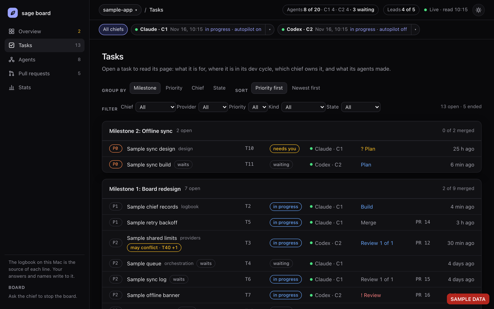
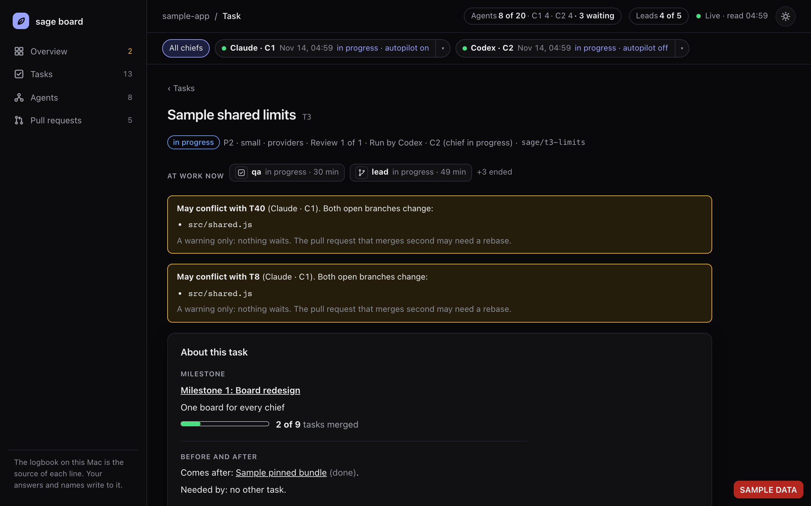
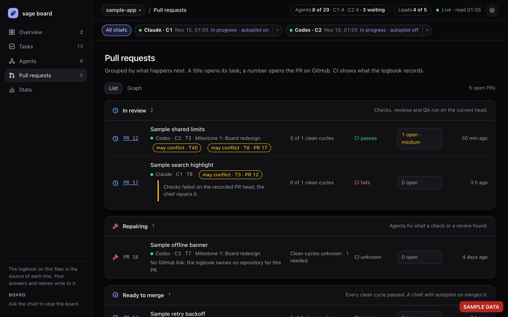

# The board

The board is a view of your projects' logbooks, one project at a time: what needs you, where each milestone and task stands, the agents that run now, and the pull requests. This page is the user guide to the board.

The board has two views:

- **The board in the chat:** `show board` prints a short digest as text: what needs you, what moves now, what was done since yesterday, and the milestones. It needs no server and no scripts.
- **The board in the browser:** a local page on this Mac, at `http://127.0.0.1:43123/` (or the [port that you moved it to](#change-the-boards-port)). It needs scripts, and it reads the same logbooks.

[Every phrase](using-sage.md#every-phrase) lists the board phrases with all the others. The [board service guide](../../packages/sage-board/README.md) gives the server's setup by hand and the login service.

The board reads. It writes only the few actions of a [paired browser](#act-from-the-board). To change a task, a priority or a kind, ask the chief.

Every screenshot on this page shows sample data, made by `scripts/board-shots.mjs`.

## Ask for the board

The chat view shows the tasks in the project's logbook: its shared logbook, or else the logbook of the tool that you use (Claude or Codex). The browser view reads the logbooks in its config: by default, the Claude and the Codex logbooks and the [shared logbooks](#a-shared-project-on-the-board). It shows [one project at a time](#one-project-at-a-time), and the link in the chief's reply opens it on the project of that chat.

| Say | You see |
| --- | --- |
| `show board`, `sage board`, or `show board for this project` | The chat board for the current checkout, and the address of the board in the browser. |
| `show board for all` or `sage board for all projects` | Tasks from all configured sources. |
| `show board for sage-bot` or `sage board for sage-bot` | One named project: the name that the board shows (its display name, or its repository's name) or its folder's name, in any letter case. The Claude and the Codex logbook of one checkout are one project, so the name shows both. An ambiguous name (two clones) gives qualified project choices. |
| `show board T197`, `sage board T197`, or `board T197` | Full task detail for the current project. An unknown task gives nearby IDs and opens no other task. |
| `show status` or `sage status` | Task states, recorded agents, what needs you, and the budget evidence that the logbook has. |

Claude recognizes these phrases only at the start of your own message, outside quoted text:

- Bold around the phrase works, for example `**show board**`.
- A question mark works right after the phrase, also inside the bold (`**show board?**`). After the closing stars (`**show board**?`), it does not work.
- Text after a question mark on the same line does not trigger the phrase.

Codex recognizes the same phrases by the same rules. There, the board in the browser starts after you approve one prompt, as [The board in Codex](codex.md#the-board-in-codex) tells.

### The chat board

The chat board is a digest that you read at once. It answers one question: "Do I need to do something, and is the work moving?" The board in the browser is the place to look around.

It has four parts, always in this order:

1. **Needs you:** each open question, with its options and the chief's recommendation; each problem of a milestone or a logbook; and each chief that stopped with open tasks. 🔴 marks the part only when something waits for you.
2. **Moving now:** each task past the backlog that does not wait for you, or that an agent works on, with what it does and how long its agent has run. A task that the chief must repair (for example, the merge check refuses its last commit) says so here.
3. **Done since yesterday:** the tasks merged or concluded today or yesterday, newest first, with the local time.
4. **Milestones:** one line for each release that is not done, then one line for each open milestone, with its count of merged tasks and its next task.

Each part shows at most 6 tasks, then "And 4 more on the board". Then come:

- **Quiet:** the count of the other projects that have nothing that moves or needs you.
- **More:** the link to the board in the browser.
- **Ref:** the last line. It keeps the ids of the tasks, questions (with their full key), milestones, chiefs and pull requests above it, for the chief. The text above it names things by their titles, not by their ids.

Other rules of the digest:

- It leaves out the backlog, the sessions, the pick-ups, the step lines, the priorities and the kinds. The browser shows them.
- When two or more projects have work, each part groups its lines under the project's name, and the Ref line names the project too.
- The head line gives the time in your local zone, and names the zone once.
- Titles longer than 60 characters end at a word, with "…".
- Agent text shows as plain text: it makes no link, no image and no HTML in the chat.

A sample, with SAMPLE DATA:

```text
sage board · 10:43 UTC-05:00

### 🔴 Needs you
sage-stack
- Pages link to the board only when it runs. The board cannot tell if autopilot is on, so review and merge its PR.
- Pick the layout of the release notes. Which layout do the release notes use?
  Options: 1 one page · 2 one page for each project.
  Recommended: one page.

sedalina
- Choose the checkout layout. Checkout layout: A (one page) or B (three steps)?
  Options: 1 A · 2 B.
  Recommended: A.

### Moving now
sage-stack
- Hook slots free themselves when a session dies, so that a… Building, 20 min.

sedalina
- Fix the cart total. Building, 1 h 15 min.

### Done since yesterday
sage-stack
- Read-only roles cannot write into the agent folders. Merged at 09:40.

### Milestones
sage-stack
- Board redesign: 1 of 4 merged. Next, Hook slots free themselves when a session dies, so that a…

Quiet: 1 other project has nothing that moves or needs you.

More: http://127.0.0.1:43123

Ref: sage-stack T1205 PR 645 T1210 claude/sage-stack-aaaaaa/G236 T1204 T1199 PR 641 M7 · sedalina T88 claude/sedalina-bbbbbb/G62 T89
```

A verified pull request asks for your merge only when sage's merge check passes on its last commit. The board does not check the pull request's head branch on GitHub.

### The state words

Each task, step, milestone and agent shows one of six state words, in the browser and in the task detail of the chat (`show board T197`). Each word has a mark, so it reads without colour too.

| Word | Mark | It means |
| --- | --- | --- |
| not started | ○ | The task exists, and no agent works on it yet. |
| waiting | ⧗ | It cannot start before another task, or before you approve its milestone. |
| needs you | ? | It waits for your answer to a question, or for your merge. |
| in progress | ▶ | Agents or the chief work on it. |
| done | ✓ | It merged, or it was a study that ended. |
| stopped | ■ | Its work stopped for good. |

The same words and marks show the steps of a task and the agents, from one table in sage's code. Two more marks:

- `!` is a problem: failed, blocked, may be stuck, running long, run still open or lost. The problem shows after the word, for example "in progress · may be stuck".
- `◌` is a state that the board does not know. It reads "unknown".

Two marks are not states:

- `⊘` is a wait that is never met: the task that it waits for stopped, so this task cannot start. For example "⊘ Waits for T20 (pilot, stopped): it cannot start".
- 🔴 marks the chat board's Needs you part when something waits for you.

Each kind tag (for example `◇ Design` or `⋈ Orchestration`) has a mark of its own, which no state uses.

- A wait names the word of the task that it waits for, for example "Waits for T12 (in progress)".
- A milestone's word comes from its breakdown: "needs you" while the breakdown waits for you, or when its pilot stopped; "stopped" when you dropped it. Else it comes from its tasks.
- The status lines that the chief shows you (the `status` command) give the word of each release and each milestone. Their tasks line keeps the tool's own states.

## The seven jobs of the board

The board in the browser answers seven questions. Each answer is at most two clicks from the Overview, and a browser test walks each one on sample data (`scripts/board-jobs-browser.test.mjs`).

| Job | Clicks from the Overview | Where |
| --- | --- | --- |
| What needs me, with full context | 1 | Overview, Needs you: a click on a question opens the question view. |
| Where each milestone and task stands, by priority | 0 for milestones, 2 for tasks | The Milestones card. Tasks, then "Priority" in Group by. |
| Where a task is in its dev cycle, and what its agents made | 2 | A milestone, then a task: the task page. |
| Which agents run, for which chief, against the limit | 0 or 1 | The counts in the top bar; a click opens the Agents page. |
| Which PRs are open, merged or waiting, and what depends on what | 1 or 2 | Pull requests; Graph shows the waits. |
| What changed since I looked | 0 | The counts at the end of the Overview. |
| Whether each chief runs, and whether autopilot is on | 0 | The chief chips under the top bar. |

## One project at a time

Each page of the board in the browser shows one project: the Overview, Tasks, Agents and Pull requests. No page mixes the rows of two projects. Only [Stats](#stats) counts all projects, and it shows numbers and charts, never a task list.

- **The project that opens:** the link from `show board` names the project of that chat, so the board opens on it, in Claude and in Codex. A chat in a subfolder or a linked worktree of the checkout opens the same project, and the link from `show board for sage-bot` opens `sage-bot`, as the chat board does.
- **No project in the link:** after `show board for all`, or from a folder of no project, the board opens on the project that you looked at last in this browser. A name in the address that the board does not show opens that last project too, with a short notice that names it.
- **The address:** it keeps the project, for example `/app/#tasks?project=sage-43265b`. A reload keeps the project, and Back returns to the project before.
- **The picker:** click the project's name at the start of the top bar. Projects that need you come first, then the others by their last work. A row says "2 need you", "1 agent · 5 min ago" or how long ago the last work was.
- **Find:** with 8 or more projects, the field "Find a project" at the top of the picker filters the rows by name.
- **Older:** a project with no work for 30 days folds into the Older list by itself, also when it has open tasks. A project with a question that waits for you never folds. An Older project opens like any other, and it comes back to the top list when work starts.
- **Work:** a run, a decision, a question asked or answered, or a merge. A project with no task uses the time of its decisions.
- **Archived:** a project that you archived is in the Archived list, with the day of the archive and a Restore button, and its name has the mark "archived". Its pages still open under a banner with Restore, but the board takes no answer for it: its Needs you card marks each question "Restore to answer" ([Archive a project](#archive-a-project)).
- **The signal:** "2 other projects need you" in the top bar counts the other projects with a question for you. Older and archived projects never count. A click lists them, and a click on one opens its Overview, with its Needs you.

## Archive a project

Archive puts a project away when you stop work on it. Restore brings it back where it was. Both need a [paired browser](#act-from-the-board), or ask the chief in the project's chat; when the browser is not paired, the confirm has the pairing box.

1. **Archive:** point to the project's row in the picker and choose Archive, or choose "Archive project" at the foot of its Overview.
2. **Confirm:** the board asks first. It names what the logbook keeps (tasks, milestones, findings and answers), and it warns when agents run, pull requests are open or a question waits for you:
   - A running agent finishes its run. Then the chief starts nothing new in the project.
   - An open pull request stays open on GitHub. Nothing closes or merges it.
   - A question waits in the archive. You answer it after Restore.

   The confirm keeps the keyboard inside it, and Escape closes it.
3. **Undo:** for 10 seconds after the archive, the note "<project> is archived" has Undo. Undo opens no Welcome back. After that, use Restore.
4. **Restore:** choose Restore in the banner on each page of the archived project, or on its row in the Archived list of the picker.
5. **Welcome back:** after Restore, the Overview shows where each task stood (the states that the logbook recorded), what waits for you and the next step. Open pull requests may need a merge of main and fresh checks, and the chief checks this first; the board runs no Git, so it counts no new commits of main. Welcome back ends when you close it or when a run starts.

What the archive writes:

- The board runs `config archived=yes` (Archive) or `config archived=no` (Restore, Undo) through the state tool, in each live logbook of the project: the shared logbook, or a Claude or Codex logbook of a project that has not moved to the shared root.
- The state tool records one decisions row for each change, with its time. The board reads the newest row for "Archived on 12 Aug" and for Welcome back.
- When one of two logbooks refuses, the note names it, for example "Archived in 1 of 2 logbooks. The Codex logbook of recipe-box did not save.", and says what the board shows, with Try again, which runs the same Archive or Restore. The note gives no reason, because the reason names files of the logbook.
- When no logbook saves, the confirm stays open with the reason and Try again.
- The board reads the logbooks that name their checkout (`checkout.txt`); when none names it, it reads them all. It shows the project as archived when each logbook that it reads is archived.
- While these logbooks disagree, each page of the project has a banner, also after a reload, for example "The Codex logbook of recipe-box is archived, and the Claude logbook is not." A paired browser gets Archive and Restore there.
- The board runs one Archive or Restore at a time, so two tabs that send them at once do not leave the logbooks mixed.
- The chat that sent the link names its project. When that project is archived, the banner says so, and you can restore it there.

## The Overview


The address of the board opens the Overview. From the top:

- **The top bar:** the [picker and the signal](#one-project-at-a-time), then the counts of agents and leads against this project's limits, for example "Agents 8 of 10 · C1 4 · C2 4 · 3 waiting" and "Leads 4 of 5". A count turns amber at its limit, and a click opens the Agents page.
- **All projects:** with more than one project, "12 in progress in all projects" counts the running agents of every project. The board does not read Claude's total cap of agents for all projects, so it shows no limit for that count.
- **The time and the theme:** "Live · read 10:56" gives the time of the last read. The board is dark until you choose the light theme with the switch, and it keeps your choice in this browser.
- **The chief chips:** one chip for each chief, Claude and Codex alike, with a green dot for a live chief, a yellow dot for a quiet chief or a chief that waits for your answer, a ring for a stopped chief, and "autopilot on" or "autopilot off". A click on a chip shows only that chief's work, on each page; "All chiefs" shows all again. In a window narrower than 760 px, the chips fold into one chip with each chief's id and dot; a tap shows them all.
- **Sessions:** one row for each sage session (chief) of the project, Claude and Codex alike, with its dot and its state word:
  - **live**, with its start time, its tasks and its agents, for example "Claude · C3 · since 21:07" and "14 tasks · 3 agents". "program not confirmed" says that sage did not yet see the session's program in two actions 1 min apart: the session then passes on only when it exits, or after 8 h with no action.
  - **quiet**: no action for 30 min or more and no agent at work. It shows when its tasks pass on, for example "passes on at 17:10", 8 h after its last action. A quiet session with an open question of yours keeps its tasks.
  - **stopped**, after 8 h with no action, or **ended**, after a clean exit or the off phrase, with the time and its runs that the logbook still shows as running: "1 run lost".
  - **The last pick-up** of the last 7 days, at the end of the row. The session that took the work says "picked up 146 tasks at 15:59", with "1 run lost" when a run of the stopped session was running. The stopped session says "passed on to C3 at 15:59".
- **Needs you:** each open question and each problem, oldest first, with its chief, its task and when it was asked. A click on a question opens the [question view](#the-question-view-and-the-reader).
- **Milestones:** each milestone by the top priority of its open tasks, with its state word, its goal, its progress bar ("2 of 9 merged") and its pilot. A click opens the Tasks page with only that milestone's tasks; "Show all tasks" shows the rest again.
- **Since you looked**, or **In the last 24 hours** on the first visit in a browser, or **In the last 7 days** after a longer absence: the tasks merged, the runs "with a problem flag", and the tasks added. A run has a problem flag when its agent is silent for 30 minutes or stopped, or when it failed in the last 24 hours, its task is still open, and no later run of the same role started. A click on "Merged" opens those tasks on the Tasks page, newest first; a click on "With a problem flag" opens the Agents page, which uses the same label.
  - **Pick-ups**: one line for each pick-up in the same time, with its time, the session that took the work, the count of tasks from each source and the lost runs by id. For example "20 Nov, 15:59 · Claude · C3 picked up 146 tasks: 69 from Claude · C1, 2 from Codex · C2 and 75 with no owning chief · no run lost".

When the board has no project yet, the Overview shows one card, "Start your first task", with the three first steps: start a chief in the project, ask for a change, and come back to the board. A project that has a chief but no task yet shows the same card, with the first step marked done.

Needs you also has items that no task holds: a stuck milestone, a breakdown gate that the logbook lost, a milestone that tasks name but the logbook does not have, a table or a logbook that the board cannot read, and an open move gate ([the move](using-sage.md#move-an-existing-project)). Each item says why and what to do.

When the merge check refuses a PR's head, or the checks or QA failed on it, the chief must fix it: the task stays "in progress" with the reason (for example "Checks failed on the recorded PR head; the chief repairs it."), and it is not in Needs you.

## Tasks



The Tasks page lists every task, grouped by milestone (the default), priority, chief or state, and sorted by priority (the default) or newest first. Filters show one chief, provider, priority, kind or state. A click on a row opens the task page, and each page of the board opens at its top.

- Each row shows the priority, the title, the kind, the state word, the chief tag (id and provider), the step that runs now, the PR and the age.
- "may conflict" shows when another chief's open branch changes the same file.
- The tasks that ended (merged, concluded, abandoned) fold under each group.

Every task has a priority (P0 to P3). An older open task with none shows "no priority", so that you can ask the chief to set one.

## The task page



Each task has one page, at `/app/#task?key=<task key>`. The Overview, Tasks, Agents and Pull requests pages open it. The browser's Back returns to the same place on the page that you came from, and a click with Cmd (Ctrl on Windows and Linux) opens it in a new tab. From the top, the page shows:

- the title, the state word, the priority, size, step and chief, and the agents at work now;
- the tabs About, Artifacts, Log and Decisions. About opens first.

About shows, in this order:

- for a merged task, "What changed for you": the "What changes for users" part of its PR's description, which the logbook keeps when the task merges; else the RESULT of its newest lead's report, labelled; else "The board has no text for this change";
- for each failed run with no later run of the same role, while the task is open: "Failed run", the reason and where it comes from (the run's failure line, else the RESULT of its kept report, else the chief's "R12 failed:" decision, else "No reason recorded"), and a link to its report when the logbook keeps one;
- Milestone, Before and after ("Comes after" and "Needed by"), Goal, Why, Criteria, Status and Cost, then the links to the brief, the reports, the pull request and the milestone. A task that stopped shows no step as "now".

Artifacts lists the task's pages folder, the briefs and reports of its runs, and its design versions; each opens in the [reader](#the-question-view-and-the-reader). A run shows a Brief or a Report link only when the logbook keeps that file; else "No brief", "No report", or "Report when it ends" for a run that runs.

| Part | Where it comes from |
| --- | --- |
| Goal | The GOAL field of the lead's brief (or of the newest brief of the task). |
| Why | Your request, which the chief records with `task <T> set request="..."`. |
| Criteria | The ACCEPTANCE lines of the brief. A line shows "met" only when a passing review or QA report of the task names it; else "not checked yet". |
| Cost | The agent time and tokens of the task's runs, against the BUDGET field of the brief. |

A part with no data shows "unknown" and the reason, for example "The logbook keeps no brief of R25". A path or a branch name shows each control character in it as a visible escape, such as `\n`.

`show board T197` gives the same task in the chat: its steps, brief, runs, verdict evidence, findings (with the polish list of open low findings), artifacts and latest decisions.

## The Agents page


The Agents page (`/app/#agents`) shows every agent of the project that runs now, for Claude and Codex. It only reads. The page shows:

- the seats: one square for each running agent, grouped by chief, then the free seats, the limit mark and the queued runs as dashed squares;
- each chief under its C1 or C2 tile, Claude and Codex alike, and a stopped chief as stopped, with the open tasks that it owns;
- each running lead as a card with its helpers. Each agent is a tile with its role's line glyph and its role word. The outline round the tile shows its state; only a running outline moves, and the system's reduced-motion setting stops it. Ended helpers fold under "Show n ended helpers";
- an arena as one card: its candidates, then the judge;
- the chief's own runs, one row for each task, and its queued runs with their place in the queue;
- a timeline with one lane for each agent, with its glyph.

A click on a card's title, on "About" or on an agent opens the task page. A run that ended shows "done", "stopped · failed" or "stopped · blocked", and a queued run shows its place, for example "waiting · 1st in the queue". A failed run shows "Reason:" and its reason, from the same sources as on the task page.

| State | Shown when |
| --- | --- |
| ▶ in progress | The hook saw the agent in the last 30 min. A Codex run also shows this word: the logbook says that it runs. Codex sends no activity notes yet, so the row has no last activity, no helpers and no cap. |
| ⧗ waiting | A lead has at least one helper that still runs. |
| ! in progress · may be stuck | No hook activity for 30 min or more, and no running helper. Or the logbook says that the run runs, and no agent slot holds it (the hook frees a slot after 60 min with no activity). |
| ! in progress · running long | The time running is more than 2 times the median of the same role's ended runs in this project. It needs 5 ended runs. |
| ! stopped · run still open | The hook saw the helper stop, but the logbook still says that the run runs. The chief must end the run. |
| ! stopped · lost | The session of the run's chief stopped or ended, but the logbook still says that the run runs. No agent works on it. |

The page reads files only: the logbooks, the hook's agent slots and helper notes (by name and time, not their content) and the limits in `config.json`. It runs no command and reads no process list. To join a slot to its run, the hook marks each agent slot with the run id from the first line of the agent's brief ("Run R12 · task T3").

## Pull requests



The Pull requests page (`/app/#pull-requests`) groups the tasks with a PR by the next action: Needs you, Building, In review, Repairing, Ready to merge, Waiting for another task, and Merged recently (the last 7 days). Each row shows the PR number (a link to GitHub when the logbook names the repository), the title, the chief tag, the milestone, "may conflict", the clean cycles, the CI state from the ledger ("CI passes", "CI fails" or "CI not known") and the open findings ("1 open · medium"). The board never asks GitHub.

**Graph** draws each PR and each task that waits for another one in columns: an arrow from A to B means that B waits for A. A dashed link joins two tasks that may conflict, and a loop of waits shows one link that goes back, marked "loop". The page keeps the List or Graph choice in this browser.

## Stats

Stats (`/app/#stats`) is the last link in the left column. It shows numbers and charts from the logbooks on this Mac, and never a task list.

The **Show** list at the top picks **All projects** (the default) or one project; archived projects count too, with the mark "(archived)". The address keeps the choice, for example `/app/#stats?show=sage-43265b`. The Show list is the only scope on Stats: the top bar shows no picker there, and the chief chips do not show.

| Number | What it counts |
| --- | --- |
| Pull requests merged | Tasks merged in the last 8 weeks, per week (weeks start on Monday, UTC), and by project. |
| Open tasks | Open tasks now, by their state word: not started, waiting, needs you, in progress. |
| Need you | Questions and merges that wait for you now, by project; the same count as the picker. |
| Agent time | Hours from the start to the end of each ended run, per week and by project. A run that still runs does not count yet. The runs of a task that moved to the shared logbook stay in its old logbook, and they count in the project. |
| Tokens | The token counts of the runs, per week and by project. A run with no count is left out, and the tile says how many. |
| Repair rounds | The repair rounds of each pull request merged in the last 8 weeks: 0, 1, 2, 3 or more, and the median. |
| Money spent, your own time | "not recorded yet": the logbooks do not keep them, so Stats does not guess them. |

Each chart has a table with the same numbers for a screen reader, and a bar shows its number when you point at it. A column chart names what it counts on its side (for example "Hours") and under its columns (for example "Week that starts on Monday (UTC)"), and each week shows its day and month.

- **Loading:** Stats says how many logbooks it reads.
- **Empty:** with no task in any logbook, it says "No numbers yet".
- **Part failed:** when a logbook file cannot be read, one banner says what the numbers leave out, for example "the agent time and tokens of the Claude logbook of sage" when only its runs cannot be read. The rest still counts. A config.json that cannot be read leaves out nothing.

The board reads Stats from the newest read of the logbooks, also while the other pages show the last good copy, and Stats reads again when its numbers change.

## The question view and the reader


A click on a question in Needs you opens the question view (`/app/#question?key=<gate key>`): the full question as the chief kept it, the question's default (for example "If you do not answer: C1 takes A"), then each answer as a card, with the chief's pick first. With a paired browser, you pick an answer and Send it here ([Act from the board](#act-from-the-board)). "Read the full question" opens it in the reader.

**Material** is beside the answers: what you may need to read before you answer, at most 8 items, in this order:

1. **Named:** the pages that the question names. A page of another task in the same logbook opens too. A page of a task that the board does not have in that logbook (for example a task of the other logbook of the same repository) shows a note instead.
2. **Task pages:** the design of the question's task, the prototype of its newest version, then its Markdown pages, newest first. Pages of the tasks that it waits for are not listed.
3. **Asking run:** the report and the brief of the run that asked the question. For an older question with no run recorded, the newest designer, pe or investigate run of the task, and it says so.

A click on an item opens it in place, and the answers move beside it, so you can answer while you read:

- "‹ The question" goes back, and "Open full page" opens the item in a new tab.
- When a page shows one answer, "See answer A in …" under that answer opens it.
- With more than 8 items, "All of T10's pages" opens the task's Artifacts.
- After you send, "Needs you · 1 left: G6 from C2" opens the next question. When this project has no question left but another project has, the line says so, for example "Nothing else waits in sample-app · 1 other project needs you: other-app", and opens that project.

Each item opens in a frame that cannot act for the board:

- A reader page runs no script. A link to another reader page of the same task opens in the frame. Every other link (a board page, a prototype, the pages index, another site) opens in a new tab, so the question view and your picked answer stay.
- A design prototype runs its own scripts in a sandbox, below one warning line. They cannot read the board, its storage or cookies, call the board's API or move the board's window.
- A picture shows as a picture.

The report of the run that asked shows "This became G4." at its top, with a link to the question.


The reader (`/read/...`) shows what the agents made as plain pages of the board, each with a back link to where you came from: a brief, a report, a Markdown page with its contents list and its pictures, a design (one version, or two side by side), an arena (the candidates, the scores and the judge's final), and a question. It runs no script. Its question page says "Answer on the board or in the chat", with a link to the question view.

A page says "not written yet" while its run runs, "not kept" for a run older than the kept briefs, and "gone" for a recorded page that is no longer in the pages folder. The [board service guide](../../packages/sage-board/README.md#the-reader-for-agent-documents-t1064) gives its routes and its safety rules.

## Narrow windows


The board is for a desktop window from 1024 px wide. A narrower window still works: below 900 px, the menu moves above the page, and the cards and the answers stack in one column.

In the question view below 900 px, the material goes under the answers; while an item is open, a bar at the bottom of the window keeps "‹ Question", a button for each answer and Send. The bar also shows the result of Send: the answer that the logbook recorded, or the reason that the board refused it.

The board is for this Mac only: it has no phone or remote access.

## Act from the board

With a paired browser, you act from the Overview:

| Action | Clicks from the Overview | What it writes |
| --- | --- | --- |
| Answer a question in Needs you | 1 to open it with its full context (the question message that the chief kept), then pick and Send | `gate answer --via board`. The chief that owns the question applies the answer at its next step. |
| Approve a design with your words | 1 to open the design question, then pick Approve with your words, type your words in the field under the answers, and Send | `gate answer --via board --option 2 --other-hex <your words>`, at most 1,000 characters ([A design question](using-sage.md#a-design-question)). |
| Undo a board answer | 1: Undo, under "Answered · waits for the chief" | `gate undo`, until the chief picks the answer up. |
| Rename a chief | 2: the chief's menu (▾), then Rename | `chief name`. An empty name clears your name. |
| Show only one chief's work | 1: the chief's chip. "All chiefs" shows all again | Nothing: the filter holds on each page, in this browser tab. |
| Give a task of a stopped chief to another chief | 2: Give to another chief, then Open the takeover question | `gate give`. Nothing moves until you answer the takeover question. |
| Archive the project | 2: Archive project (at the foot), then Archive. Or 3 from the picker | `config archived=yes` in each logbook of the project ([Archive a project](#archive-a-project)). |
| Restore an archived project | 1: Restore, in the banner or in the picker's Archived list | `config archived=no` in each logbook of the project. |
| See what changed since you looked | 0 | Nothing on the Mac: each browser keeps the time when you last left the board (the tab closed, or hidden for 5 minutes). A reload keeps the counts. |
| Stop the board | 2: Stop the board (at the foot of the side bar; in a narrow window, under the page links), then Stop the board in the question that it asks | Nothing in a logbook: the board server closes for every browser, and the chiefs and their agents keep working. To open it again, type `show board` in a chief's chat. A browser that is not paired shows "Ask the chief to stop the board." |

The first answer wins. When you answer in a chat or on a card first, the board shows where and when, for example "Answered first in C2's chat at 14:51", and a later board answer is not recorded.

**Pair a browser once.** Until you pair, the board only reads. Type `show board` in a chief's chat, and click the link in its reply: one click opens the board and pairs the browser.

The chief makes the link with `board --ensure --link`:

- The link has the form `http://127.0.0.1:<port>/app/#pair=<key>&project=<folder>`. The key is 256 random bits. It is after the `#`, so the browser never sends it in a request line, a log or a referrer.
- The folder is the logbook folder of the chat's project. The command finds it from the chat's folder (`--project`), or from the asked name (`--name-hex`, the name's UTF-8 bytes in hex), with the chat board's rule. It writes nothing and runs no other program; the link has no path.
- The board takes the key out of the address bar and the history at once, keeps the project, then sends the key once. The server keeps only its hash, in `pair-link.json` in the board's state folder.
- A link that you paste into a board tab that is open already pairs it at once, with no reload. A query in the address (`/app/?…`) changes nothing: the board opens.
- A link pairs one browser, once, within 10 minutes. A new link ends the older one.
- The hooks refuse `--link` from an agent: only the chief runs it, and the chief puts the link in the chat text only, never in a file, a message page or a brief.

After the click, a note on top of the Overview gives the outcome and the next step:

| Outcome | What the note says |
| --- | --- |
| Paired | This browser is paired, and the link is used up. |
| Already paired | Nothing changed. The link no longer pairs any browser. |
| Used | Another browser on this Mac used the link, and when. The note has the button **Unpair every browser**, for the case that it was not you. |
| Replaced | A newer link replaced this one. |
| Expired | The link is older than 10 minutes. |
| Refused | The board does not know the key: it is not a link of this board, or it is older than the board's last 8 links. |

For each outcome except Paired and Already paired, type `show board` again for a new link.

**Unpair every browser** works without pairing. It removes every pairing, so each browser reads only until you pair it again. A program on this Mac can also send it; the worst result is that you pair again.

**No chat open?** Pair with a Terminal code. The pairing card shows the command, with its full path, for example `node '<board folder>/cli.mjs' board --pair` (single quotes only when the path needs them):

1. Choose Copy, then paste the command in Terminal on the Mac, and run it. It prints a one-time code that works for 10 minutes.
2. On the board, type the code in the "Pairing code" field, and choose Pair.

If the page shows no pairing card, the board that runs is older than your sage: run the `board --stop` command that `board --pair` prints, ask for the board again, and reload the page. When a browser loses its site data, it pairs again.

`board --pair` refuses to run when its input is not a terminal, and the hooks refuse it from an agent.

**What the board checks.** Each write is a POST to `/api/...`, and the server refuses it unless all of these hold:

1. The `Origin` is the board's own address, `Sec-Fetch-Site` is `same-origin`, and the body is JSON. The server answers no CORS preflight, so a page on another site or port cannot send one. A `/pages` page with scripts has the origin `null`, and the server refuses it.
2. The browser has the pairing cookie (`HttpOnly; SameSite=Strict`). The board keeps only its hash, in the board's state folder (`~/.config/sage-board/state`).
3. The request carries the pairing token of the same browser. The server gives it to the page once, when you pair, and keeps only its hash. The page keeps it in `localStorage`, which belongs to the board's own address and port, and a `/pages` page runs in a sandbox without it.
4. An answer names the digest of the question and the options that you saw. When the question changed, the state tool refuses the answer.
5. The board runs only your commands: `gate answer --via board`, `gate undo`, `gate give`, `chief name`, and for Archive and Restore exactly `config archived=yes` or `config archived=no`, through the state tool, in its own thread. It never claims, accepts or writes a task.

A browser sends the cookie to every server on `127.0.0.1`, also on another port. That server never gets the token, so the cookie alone writes nothing.

Which logbooks the board writes:

- Answers, undo, give and names write only a shared logbook, and only for a project that is not archived.
- Archive and Restore name a project of the board, never a logbook or a path. They also write a Claude or Codex logbook of that project.
- For a Claude or Codex logbook, the board reads the checkout from the logbook's `checkout.txt`. It writes only when the state tool finds that same logbook folder for that checkout.
- A logbook that moved to the shared root, a `checkout.txt` that is a link, or a checkout of another project refuses.
- A logbook with no checkout on this Mac refuses. Then answer or archive in the chief's chat.
- A Claude or Codex logbook gets its `checkout.txt` at the next command of the chief that writes to it, such as `task add` or `gate add`. The state tool never replaces a `checkout.txt` that is there, also when it names another checkout or is a link.
- Until that write, a logbook without a `checkout.txt` refuses, because the board cannot check its checkout. The note says so. Archive or restore it in the project's own chat.

An agent runs as your user, so a script that builds the state folder's path while it runs can still read the cookie's hash file. The sandbox is the full protection.

## A shared project on the board

A project with a [shared logbook](using-sage.md#shared-logbooks) shows as one project on both views, from Claude and from Codex. The board reads the shared root (`~/.sage`, or the root that `SAGE_SHARED_HOME` names) beside the Claude and Codex roots. A project that is not shared looks and works as before.

In the browser, each task shows its owning chief as a chip with its id and provider, for example `Claude · C1`, and the chief filter shows one chief's work. The chat board and the chat task view (`show board T320`) give these lines too:

| Line | Where in the chat | What it says |
| --- | --- | --- |
| `Owning chief: Claude · C1` | The task view | The owning chief and its provider. A task with no owning chief says `Unclaimed`: the next pick-up of another chief takes it (a moved task that no chief claimed, only a chief of its own provider). The chief that unclaimed it gets it back only through your takeover gate. |
| `Hand this task from Claude · C1 to Codex · C2? 2 of its runs end as failed.` | Needs you | An open takeover gate, with its options and recommendation: `approve, when you know that Claude · C1 stopped`. The Ref line keeps the task, the question's key and the PR. |
| `The owning chief, Codex · C2, may have stopped: its run shows no change for over 24 h.` | Needs you | A running run of the owning chief has no change in the task's rows for over 24 h. Ask any chief to open a takeover gate. |
| `R407 Claude · qa · checkout lantern · in progress` | The runs of the task view | The provider of each run, from the run's chief in `chiefs.tsv`, and the folder of the checkout that the run started from: its name only, never its path. A run with no chief stands in as `Unknown`. |
| `checkout lantern (gone)` | The same | That folder is not on this Mac now, or it is a file or a folder with no Git checkout. When it is the folder of the branch's newest writer run, one line under the runs names the folder and the run, and the next review step stops until the folder is back. |
| `checkout lantern (not checked)` | The same | The board checks at most 64 checkout folders of a logbook, so it did not check this one. |
| `checkout lantern \#2` | The same | Two linked checkouts have the folder name lantern. The number is the link order, and it never moves to another folder. |
| `was Claude T640` | The task view, and the task's card in the browser | A task that [the move](using-sage.md#move-an-existing-project) took to the shared logbook, with its old provider and number. |
| `sage moved to one shared logbook on 3 Nov.` | The top of the chat board | The project moved in the last 7 days. The line names the map page of old and new numbers, `move-map.html`, and the logbook folder that holds it. It shows no path. |
| `Old · Claude · read-only` | The task view, and the task's card in the browser | A finished task that stayed in its old logbook when the project moved. Its number belongs to the old logbook, and an open gate of it is not in Needs you. |
| `The logbook is changing` | The top of the chat board | The board read the logbook 3 times, and it changed during each read. Ask for the board again. The board in the browser keeps its last good read and reads again soon. |
| `Logbook note: …` | The end of the chat board | A row of `sources.tsv` or `bindings.tsv` that the board does not use, for example `A checkout named harbor-new is linked to this logbook, but it has no first commit in common with it.` The board stays live. |

- **Names and links:** the board takes a shared project's checkout from its row in `bindings.tsv`, so the name and the PR links come from that checkout's GitHub remote.
- **Old logbooks:** the move lists them in `sources.tsv`. The board reads a folder of that list only when it is a logbook folder directly under a Claude or Codex root, not a link, with the move's mark `moved.json`, and its row names that root's provider. Each old logbook shows once, in its shared project.
- **Agents:** a run of a shared logbook joins its agent slot in its provider's root. So a Claude run with a slot shows as at work, not as "may be stuck".
- **"Show board" in a session:** the chat board finds a shared project from its checkout, a worktree, a subfolder or another linked clone. A clone with no row does not find a shared project by its folder's name: link it first.

<!-- The old anchor stays, so that older links to it still work. -->
<a id="programs-on-the-board"></a>

## Milestones on the board

A milestone is a request that sage runs as two or more tasks for one goal, with one pilot task and a breakdown that you approve (see [Milestones](using-sage.md#milestones)).

| Where | What you see |
| --- | --- |
| The Overview's Milestones card | Each milestone by the top priority of its open tasks, with its state word, goal, progress bar, what needs you and the pilot. A milestone done more than 7 days ago leaves the card, and a line counts them. A click opens the Tasks page at that milestone. |
| Needs you | A breakdown that waits for your approval, and a stuck milestone. |
| The Tasks page, grouped by milestone | The tasks of each milestone, with "waits" on a task that waits for another one. |
| The chat | A Milestones section with one line for each milestone that is not done, with what moves next. Done milestones, and dropped milestones with no task left in them, are counts, with ": see the board's Tasks page, grouped by milestone". In Needs you, a breakdown gate is under its own heading, "Milestone approval". |

Every line that you read names a milestone by its level: "Milestone 6: Faster reviews", or "milestone 6" inside a sentence ("Waits for your approval of milestone 6").

## Releases on the board

A release is a version that you ship, such as 1.0. It holds milestones and single tasks, and it is optional (see [Releases](using-sage.md#releases)).

The chat board shows the releases: a "Where we are" section after Needs you, with boxes inside boxes (release › milestone › task) in a code block, 46 columns wide. Each task line ends with its nearest level: its milestone, else its release, else "no release" when its project has releases.

- The frame shows each release that is not done or stopped, or the last release when all are, then the open milestones and tasks in no release.
- A milestone box holds its tasks that need you or are in progress (at most 3), then a box for each other word, with its count.
- A releases table that the board cannot read is an item in Needs you, with the file and the line; the board then shows the tasks without their releases.

The board in the browser does not show releases yet. Ask for the board in the chat to see them.

## The pages of a task

Agents save each task's pages (research, designs, the pages of the chief's messages) in the task's pages folder. The board server also shows these pages, read-only, on the Mac only:

- `http://127.0.0.1:<port>/pages/<logbook>/<task>/` is the task's index: a list of its pages, with the size of each.
- `http://127.0.0.1:<port>/pages/<logbook>/<task>/<file>` opens one page. For example: `http://127.0.0.1:43123/pages/sage-43265b/T1000/research.html`.

The task page's Artifacts tab lists the pages of the task, and a Markdown page opens in the reader.

A Markdown page always opens in the [reader](#the-question-view-and-the-reader) when you click its link in a chief's message, in the index or on the task page, or when you type its address. The reader shows the page's pictures:

- a picture of the task's own pages folder, with a relative link such as ``, at most 4 parts deep;
- a `data:` picture (PNG, JPEG, GIF or WebP).

Each picture fits the width of the page, and a click enlarges it. A picture from another site, from another task, from outside the folder or deeper than 4 parts does not load: the reader shows "Picture not shown" and the picture's alt text. To see the Markdown text as it is, click "Open the file" in the reader.

The Page block of a message gives this link between its title and its file path ([sage's messages](using-sage.md#sages-messages)). So one link opens the page in the same way in each app: in the Browser pane of the Claude desktop app, in the built-in browser of the Codex app, and in your default browser from a terminal.

The board shows web pages, PDFs, pictures (PNG, JPEG, GIF, WebP and SVG), Markdown pages in the reader, and text files as plain text. It shows no other file: no logbook file, JSON, log, hidden file or link.

A page can be at most 4 parts deep in the task's folder (for example `designs/final/shots/home.png`) and at most 16 MiB. The index lists at most 200 pages.

Each page opens in a sandbox. A page cannot read the board or your files, load a style or a frame from the board or from another site, or send a form.

A page can show a picture from its own task's pages folder, with a relative link such as `shots/x.png`, or a `data:` picture. It cannot load a picture from another task or from another site.

A script from another site does not run, but if its `integrity` hash matches the switch, your browser still asks that site for it before it checks the hash. A frame to another site stays blocked, but your browser still opens a connection to that site, and the connection sends its host name.

A page with scripts of its own, for example a design prototype with tabs, opens in a frame below one warning line: "this page runs its own scripts in a sandbox". The line ends with a link to the task's index, so you can always go back to the index. In the frame, the page's scripts run, but they cannot:

- read the board, its storage or its cookies, another page or your files;
- fetch from the board or from another site;
- send a form, or open a window;
- move the browser's window, or move the frame out of the task's folder.

So in a page with scripts, only a link to another page of the same task opens. A link to the index, to a page of another task or to another site does not open: use the link in the warning line, or copy the link.

The scripts can still send the text of their own page to another site with no click: through WebRTC (a connection to a STUN or TURN server), which the page's policy does not cover. The board found no header that stops this in Chromium. Only what that page itself holds can leave this way: its scripts cannot read the board, your files or another page.

A page with no script of its own opens as it is, without the frame. In it, only sage's own script runs: the Today switch of a message's page.

A page that holds this switch and also an `http-equiv` (for example a refresh) or a `srcdoc` outside sage's own policy tag gets no script, so that a refresh cannot move it: it shows without its switch. When the board cannot judge a page, the page also shows without its switch.

The usual way out of a page with no script of its own is a link that you click in it. One way out needs no click: when a page opens, it can make your browser ask another site for an address, for example with a prerender link.

The address of that request can hold any text of the page, so that text can leave the Mac. The request carries the cookies of that site that `SameSite=Lax` lets through. The board found no header that stops this in Chromium.

A warning line in the index tells you the rest: a page may link to sites outside this Mac. When you click such a link, your browser opens that site, and the site gets everything in the link's address.

A link in a page with no script of its own to another page of the board, or to the index, opens when you click it: the board opens a page by a person's click from any site. A page cannot fetch anything from the board.

Another site can show a picture of a pages folder when it knows the picture's full address, because the board cannot tell that request from a page's own request for its picture. That site cannot read the picture's pixels. But it can learn whether a picture is at an address that it guesses, and the size of that picture.

A site that moves you to a page by itself gets "not permitted". When another site opens the index or a page with scripts in a new tab, the board cuts that site's hold on the tab, so the site cannot move the tab or read what a page sends to it.

## The board server

The board server reads your logbooks. It writes only the owner's actions of a paired browser, through the state tool ([Act from the board](#act-from-the-board)). It does not fetch from GitHub or decide whether a pull request may merge.

In Claude and in Codex, `show board` also starts the local board server on the Mac when it is not running (the first time, it sets it up from the standard Claude and Codex roots and the shared root), and the chief shows its address, or why it is not running, next to the chat board. In Codex, this start runs outside Codex's sandbox, so Codex asks you to approve it ([The board in Codex](codex.md#the-board-in-codex)). The board is for a desktop browser on this Mac only, and it needs no sign-in.

The server listens on loopback and refuses every request that is not from the Mac itself.

The sage hook refuses the ordinary command shapes by which an agent reads, copies or replaces the board config or a file of the board's state folder, lists, searches, copies or moves the board's folder (`~/.config/sage-board/`), or runs `board --pair`, and it refuses `board --ensure --link` from an agent. It does not stop a script that builds them while it runs; full protection needs the sandbox.

After you change a setting of the config, or update sage, the line says that a restart is needed: run the `board --stop` command that it gives, then ask for the board again.

### Change the board's port

The board uses port 43123. When another program on the Mac uses that port, `show board` says so and gives the command that moves the board. Run it in Terminal on the Mac:

```sh
node <board folder>/cli.mjs board --port 43124
```

Use the board folder that the message names, and any free port from 1024 to 65535 in place of 43124. Add `--config <file>` when your board config is not `~/.config/sage-board/board.json`.

You can also ask the chief to run it. An agent cannot run it: the hooks refuse it.

The command does these steps in this order. When a check fails, it stops and changes nothing:

1. It checks that the port is a number from 1024 to 65535, and that no program on the Mac uses it.
2. It checks that it can write the board config and its folder.
3. It stops this config's board, if it runs. Another program, or the board of another config, on the old port runs on.
4. It writes the new port in the board config. It keeps every other setting and the mode of the file.
5. It starts the board on the new port and prints its address.

After the move:

- The Page link of each new message names the new port. A Page link in a message from before still names the old port: change the port in that link.
- The login service (`dev.sage.board`, if you set it up) reads the port from the board config each time it starts, so it needs no change.

**The manual way.** Use it only when your sage has no `board --port`. Do these steps in this order:

1. Run `board --stop --config <file>`, with the path of your board config. Do this first: `--stop` looks for the board on the port that the file names.
2. Edit `"port"` in that file.
3. Ask for the board again.

If you edit the port first, `--stop` finds no board on the new port, and the old server runs on.

The [board service guide](../../packages/sage-board/README.md) gives local startup and the stable installation. The server runs independently of a chat.

`board --install --login-file` refuses when no upgrade-stable `node` command is on PATH, for example with asdf, Volta, fnm or a keg-only Homebrew Node. To fix it, put a `node` link to the Node that you run the install with in a folder that you own and that is on PATH (for example `~/.local/bin/node`), then run the install again.
